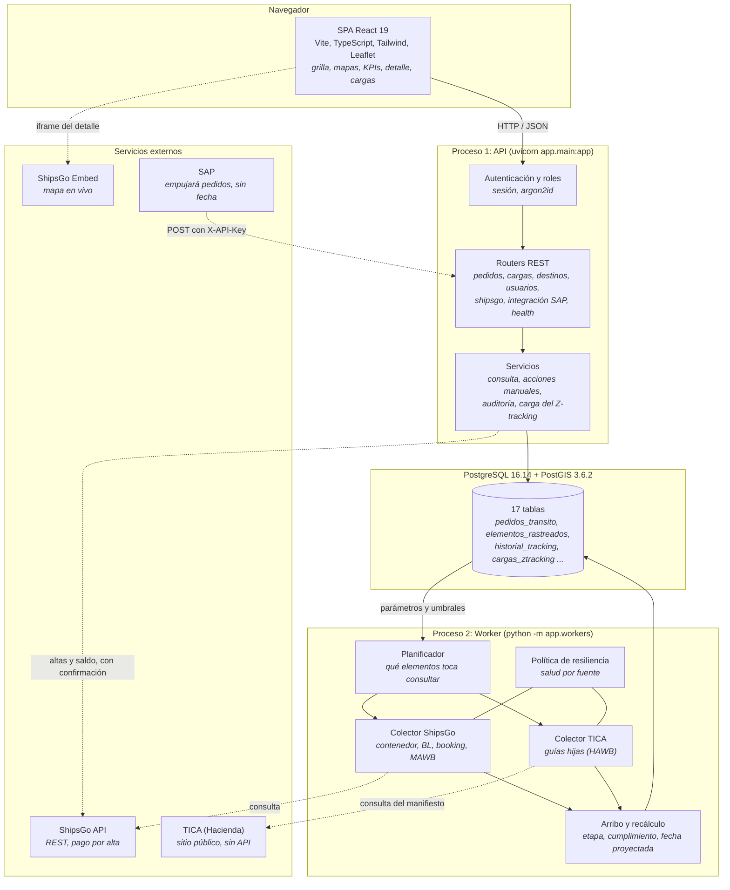
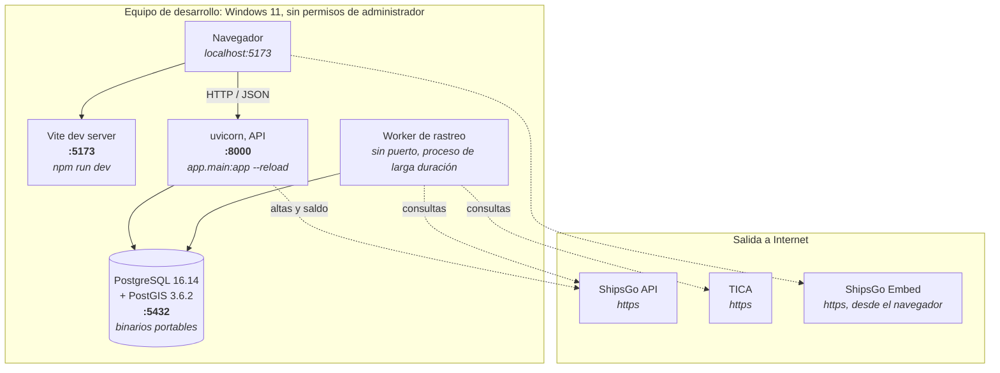
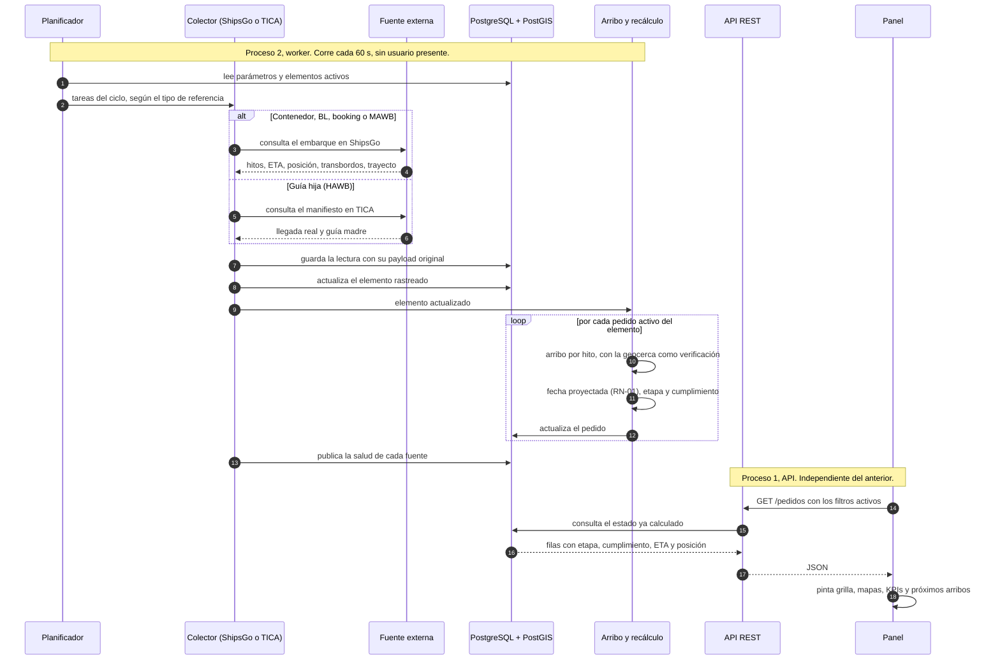

# Arquitectura

Arquitectura de TrackIn al cierre del Sprint 7 (13/11/2026). Sustituye a la versión
del 25/08/2026 (`TASK-20`, `TASK-21`, `TASK-22`), que se escribió cuando las fuentes
previstas eran AISStream y OpenSky, la ingesta venía de datos semilla y no había
autenticación. Las tres vistas se conservan; lo que cambió es lo que hay dentro.

**Fuentes normativas:** SRS v0.6 (§5.8 stack, §7 reglas), los requerimientos no
funcionales RNF-03, RNF-05, RNF-12, RNF-14 y RNF-19 a RNF-21, el spike `TASK-28`
(ShipsGo) y las decisiones registradas en `docs/adr/` y en el backlog.

## Estado

| Vista | Tarea | Primera versión | Actualizada |
|---|---|---|---|
| Componentes | `TASK-20` | 25/08/2026 | 09/11/2026 |
| Despliegue (desarrollo, instalación nativa) | `TASK-21` | 25/08/2026 | 09/11/2026 |
| Secuencia (flujo de rastreo) | `TASK-22` | 25/08/2026 | 09/11/2026 |

## Qué cambió desde la primera versión

| Antes (25/08) | Ahora (13/11) | Por qué |
|---|---|---|
| AISStream (marítimo) y OpenSky (aéreo) como fuentes | **ShipsGo** para las dos vías y **TICA** para las guías hijas (HAWB) | La cuenta de AISStream dejó de entregar datos y la zona no tiene cobertura (riesgo R1); OpenSky salió por su licencia (06/10). ShipsGo se aprobó el 16/09 |
| AISStream activo | AISStream construido como respaldo del mapa, fuera del ciclo | `US-02`, reducida por el Plan A del 04/09 |
| Ingesta por datos semilla, SAP pendiente | Carga del Excel Z-tracking desde la interfaz, como vía definitiva | 07/10: la API de SAP no va a existir para leer el Z-tracking |
| Sin receptor de SAP | Receptor `POST /integraciones/sap/pedidos`, apagado por defecto | Reunión de entrega del Informe 2 (27/10): `US-64` a `US-66` |
| Sin autenticación | Login con sesión, argon2id y cinco roles | Reunión con Logística del 03/09 (`US-42`), rol `PLANTA` el 20/10 |
| 10 tablas | 17 tablas, 34 migraciones de Alembic | Ver `data-model.md` |
| El navegador solo habla con la API | Excepción: el mapa en vivo de ShipsGo Embed en el detalle | 21/10, ver §1.6 |

---

## 1. Vista de componentes

### 1.1 Diagrama

### 1.2 Responsabilidad de cada componente

| Componente | Responsabilidad | Lo que **no** hace |
|---|---|---|
| **SPA React** | Presenta grilla, mapas, KPIs, próximos arribos, detalle, cargas y administración; aplica los filtros de forma transversal | No calcula estados ni consulta fuentes de rastreo |
| **Autenticación y roles** | Inicia y cierra sesión, verifica la contraseña con argon2id y antepone el rol a cada router (`COMPRAS`, `LOGISTICA`, `PLANIFICACION`, `ADMINISTRADOR`, `PLANTA`) | No guarda contraseñas en claro |
| **Routers REST** | Exponen 41 operaciones bajo `/api/v1` y publican OpenAPI (`TASK-04`) | No consultan el rastreo en el ciclo de la petición |
| **Servicios** | Componen la vista, registran las acciones manuales con su auditoría (RF-14), validan y cargan el Z-tracking | No escriben en `historial_tracking` |
| **Planificador** | Decide qué elementos consultar en cada ciclo según `parametros_sistema` | No interpreta la lectura |
| **Colector ShipsGo** | Lee hitos, ETA, posición, transbordos y trayecto de los embarques ya dados de alta | **No da de alta**: dar de alta cuesta y lo decide una persona |
| **Colector TICA** | Resuelve la llegada real y la guía madre de una guía hija (`US-49`) | No inventa datos que el manifiesto no trae |
| **Política de resiliencia** | Clasifica cada fallo en transitorio o permanente, calcula la espera y publica la salud en `salud_fuentes` (`US-03`, `US-51`) | No toca red ni base por sí misma |
| **Arribo y recálculo** | Aplica RN-01 y RN-05 a RN-16: arribo por hito con la geocerca como verificación, fecha proyectada, etapa y cumplimiento | No habla con fuentes externas |
| **PostgreSQL + PostGIS** | Persiste todo y resuelve distancias con `ST_Distance` sobre geografía | |

### 1.3 El puerto común de fuentes (RNF-21)

RNF-21 pide incorporar fuentes nuevas sin alterar la lógica de cálculo. El diseño lo
cumplió en la práctica: el sistema pasó de AISStream y OpenSky a ShipsGo y TICA sin
tocar el motor de cálculo. Cada fuente tiene su cliente y su colector; aguas abajo
del colector, nada sabe de dónde vino el dato.

| Tipo de referencia | Fuente | Qué trae |
|---|---|---|
| `CONTENEDOR`, `BL`, `BOOKING`, `MAWB` | ShipsGo | Hitos, ETA, posición, transbordos, trayecto, arribo |
| `HAWB` | TICA | Llegada real y guía madre |
| `MMSI` | AISStream (respaldo) | Posición del buque; el adaptador existe, pero no corre en el ciclo |
| Sin referencia | Ninguna | El pedido se sigue a mano; Compras puede registrar la ETA (`US-67`) |

ShipsGo no da la posición de un avión. El mapa aéreo dibuja una posición **estimada**
con el horario de cada tramo (`app/services/posicion_aerea.py`), rotulada como tal, y
no la escribe en `posicion_actual` para que la geocerca no la tome por real.

### 1.4 Decisión: el rastreo corre en un proceso aparte

Se mantiene la decisión del 25/08, y los motivos siguen en pie:

1. **Aislamiento de fallos (RNF-14).** Un error del ciclo de rastreo no tumba la API.
   El panel sigue sirviendo el último dato conocido aunque el worker esté caído.
2. **Ciclos de vida distintos.** La API es de petición y respuesta; el worker es un
   proceso de larga duración que consulta cada 60 segundos (configurable).
3. **RNF-03.** Las consultas externas no caben en el ciclo de una petición con un
   techo de 3 segundos para toda la vista (RNF-01).
4. **`--reload` en desarrollo.** Reiniciar la API en cada guardado no debe
   interrumpir el rastreo.

**Sin broker de mensajes.** El worker es un proceso con su propio bucle asíncrono y
la base es el único estado compartido. Un broker obligaría a instalar y documentar
otro servicio sin una necesidad real.

### 1.5 Cómo se sostiene la degradación (RNF-12 y RNF-14)

La regla que lo hace posible es que **la API nunca depende de una fuente externa para
responder**. Lo que el panel muestra ya está en la base.

- Si ShipsGo o TICA fallan, el panel responde con el último dato y su antigüedad.
- El encabezado muestra la frescura de los datos (`US-23`); `/health` reporta cada
  fuente por separado con su motivo y la antigüedad del último dato bueno.
- Una fuente que falla deja de consultarse en ese ciclo y espera lo que indique la
  política. Un fallo permanente (credencial inválida, acceso bloqueado por TICA) la
  apaga hasta reiniciar el worker. Las demás siguen.
- El ciclo confirma elemento por elemento: un fallo en uno no deshace a los demás.

Tres reglas de la política que conviene no perder:

- **El silencio no es una caída.** Una respuesta exitosa sin datos nuevos reinicia el
  conteo de fallos.
- **Un fallo permanente no se reintenta.** Lo desconocido se trata como transitorio.
- **Una fuente caída no degrada el servicio.** `status` de `/health` mira solo la base.

### 1.6 Decisiones clave que la arquitectura registra

| Decisión | Qué implica en los componentes |
|---|---|
| **ShipsGo para las dos vías** (16/09, spike `TASK-28`) | Un solo proveedor de pago para marítimo y aéreo; 1.100 créditos a US$1,70 más US$250 de la API. Las altas las autoriza Compras desde la interfaz, con el costo a la vista (`US-55`) y el saldo vigilado (`US-57`) |
| **Arribo por hito, con la geocerca como verificación** (`US-11`, 22/09) | Sin cobertura AIS en los puertos de destino, manda el hito que reporta la fuente. La confirmación manual de Planificación prevalece (RN-14) |
| **El Excel Z-tracking es la vía definitiva** (07/10) | La carga se hace desde la interfaz con plantilla, validación por campo e informe de la carga (`US-58`, `US-59`). No hay lectura desde SAP |
| **Receptor de SAP apagado por defecto** (27/10) | Si algún día SAP empuja pedidos, el contrato y la colección de Postman ya existen (`US-64`). La escucha solo la enciende el Administrador (`US-66`) y las guardas se evalúan en orden: clave, escucha, tamaño y formato |
| **Autenticación con roles** (03/09 y 20/10) | Cada router declara qué roles lo usan. Compras usa una sola cuenta con sesiones simultáneas. `PLANTA` solo ve la pantalla permanente |
| **Parámetros fuera del código** (RNF-07, RNF-15) | Umbrales, frecuencias y lead times se leen de `parametros_sistema` y del maestro de destinos en cada ciclo |
| **Mapa en vivo de ShipsGo en el detalle** (21/10) | Única excepción a que el navegador solo hable con la API de TrackIn: el detalle embebe `embed.shipsgo.com` con un token propio del Embed, restringido por los orígenes autorizados. No pasa por el backend ni toca la base. Los mapas del panel son propios |
| **Sin retención del historial** (`TASK-10`, 28/10) | Con ShipsGo el volumen de lecturas es bajo y no justifica purgar ni submuestrear |

### 1.7 Puntos abiertos

| # | Punto | Estado |
|---|---|---|
| 1 | ¿Un proceso por fuente o uno solo? | **Resuelto el 28/09 (`US-50`)**: un solo worker con ShipsGo y TICA |
| 2 | Cómo se supervisa el worker en producción | Fuera del alcance de la práctica; lo cubre la guía de despliegue (`TASK-09`) |
| 3 | Si se compra una fuente AIS con cobertura de los puertos de destino | Sin fecha; el puerto de fuentes lo admite sin tocar el motor |

---

## 2. Vista de despliegue: desarrollo, instalación nativa

**Alcance:** el entorno de desarrollo. El despliegue en servidor lo describe
[`deployment.md`](deployment.md) (`TASK-09`), con los `Dockerfile` y el
`docker-compose.yml` que se conservan para ese fin.

### 2.1 Diagrama

### 2.2 Procesos y puertos

| Proceso | Puerto | Cómo se levanta |
|---|---|---|
| PostgreSQL + PostGIS | `5432` | `pg_ctl -D ~/pgsql/data start` |
| API | `8000` | `uvicorn app.main:app --reload` desde el `.venv` de `backend/` |
| Worker de rastreo | | `python -m app.workers` desde el mismo `.venv` |
| Frontend | `5173` | `npm run dev` |

Ninguno arranca solo: sin permisos de administrador no se puede registrar
PostgreSQL como servicio de Windows.

### 2.3 Por qué nativo y no contenedores en desarrollo

Docker Desktop está instalado pero no puede correr: necesita WSL2 o Hyper-V, que solo
se habilitan con permisos de administrador. El supervisor aceptó prescindir de
contenedores en desarrollo (SRS §9.3). El procedimiento completo está en el
[manual de instalación local](manual-instalacion.md) (`TASK-07`).

### 2.4 Dependencias del equipo

| Runtime | Versión | Dónde |
|---|---|---|
| Python | 3.12 | `%LOCALAPPDATA%\Programs\Python\Python312` |
| Node.js + npm | 24 LTS | `%LOCALAPPDATA%\Programs\nodejs` |
| PostgreSQL + PostGIS | 16.14 / 3.6.2 | `~\pgsql`, binarios portables |

---

## 3. Vista de secuencia: flujo principal de rastreo

### 3.1 Diagrama

### 3.2 Lo que el diagrama afirma

**Las dos mitades no se tocan.** El worker corre sin nadie mirando; la API responde
cuando alguien abre el panel. Lo único que comparten es la base. Eso hace cumplible
RNF-03 y RNF-12.

**El recálculo es por elemento.** Una lectura de un contenedor actualiza de una vez
todos los pedidos que viajan en él, procesados uno por uno para aislar fallos.

**El historial guarda el payload original** (`US-04`, RF-21), lo que permite auditar
qué dijo la fuente en cada momento.

**Las acciones manuales entran por la API.** Confirmar el desembarco, pasar a proceso
aduanal, recibir en planta, liberar por Calidad, ajustar días o registrar la ETA
quedan en `auditoria_intervenciones` con el usuario autenticado (RF-14).

---

## Notas de contexto

- **Por qué PostGIS.** La verificación de arribo compara contra un radio en
  kilómetros; `ST_Distance` sobre `GEOGRAPHY` devuelve metros sin traer posiciones a
  memoria. RNF-20 acota la persistencia a PostgreSQL con PostGIS.
- **Por qué asíncrono.** El rastreo es de entrada y salida, no de cómputo.
- **Por qué el panel no lee `historial_tracking`.** La última posición vive
  desnormalizada en `elementos_rastreados`, que es lo que mantiene la vista por debajo
  de RNF-01.

## Referencias

- [`data-model.md`](data-model.md): modelo de datos y ER consolidado
- [`data-dictionary.md`](data-dictionary.md): diccionario de datos
- [`api-references.md`](api-references.md): contratos y hallazgos de las APIs externas
- [`manual-instalacion.md`](manual-instalacion.md): instalación local, sin Docker
- [`deployment.md`](deployment.md): guía de despliegue en servidor
- [`manual-usuario.md`](manual-usuario.md): manual de usuario del panel
- [`adr/`](adr/): decisiones de arquitectura
